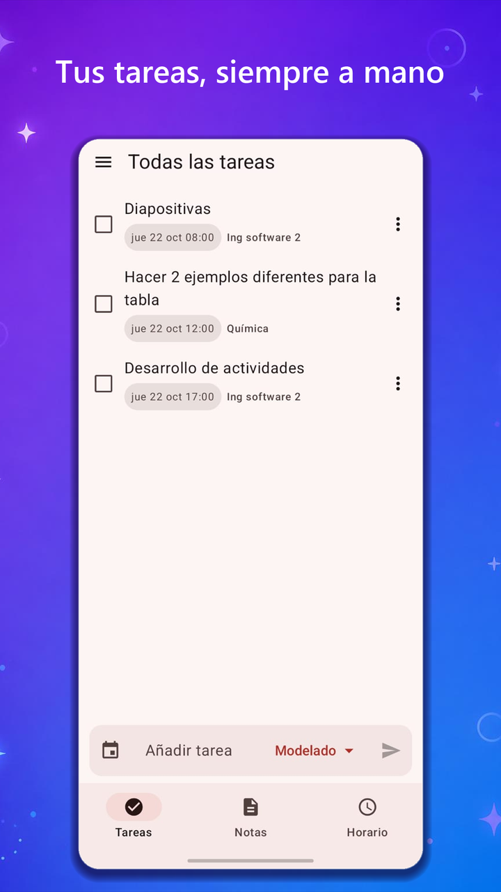
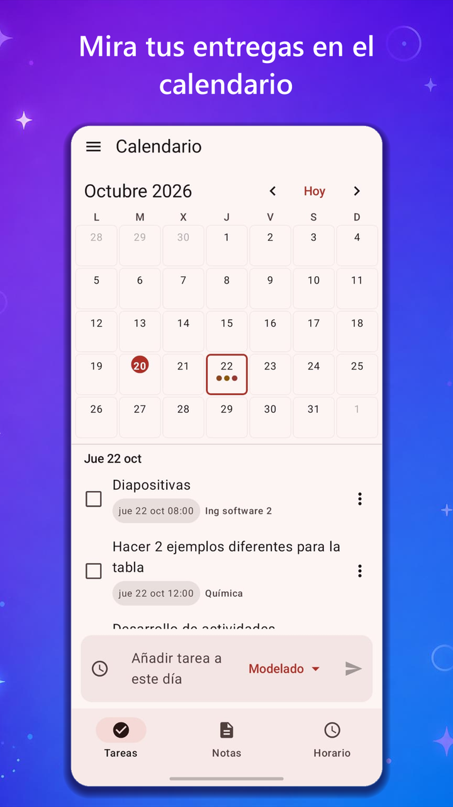
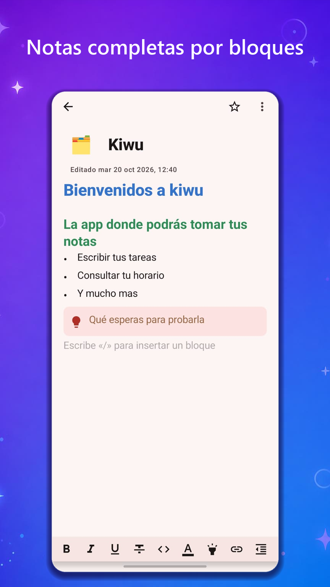
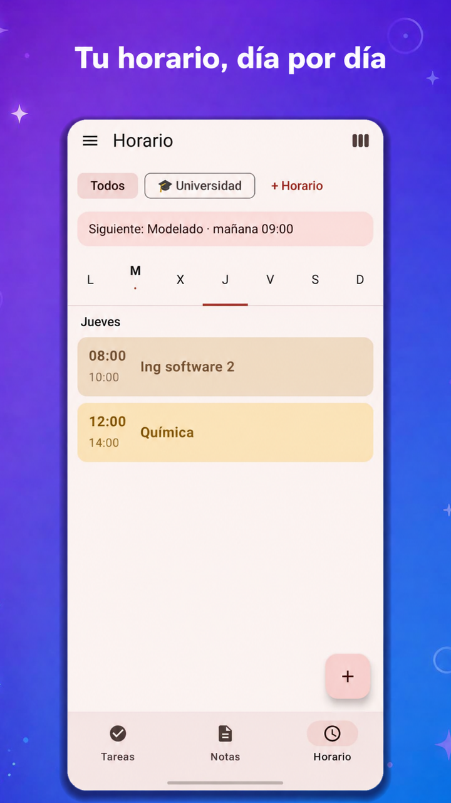
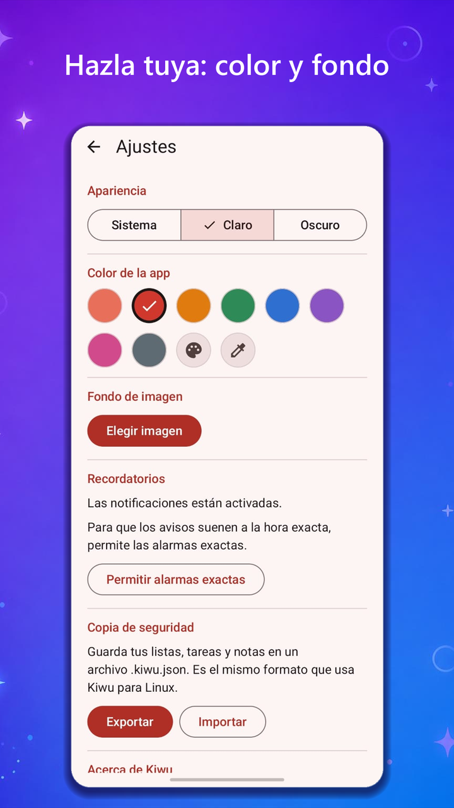

# 🥝 Kiwu para Android

<p align="center">
  
  &nbsp;&nbsp;&nbsp;&nbsp;
  
  &nbsp;&nbsp;&nbsp;&nbsp;
  
</p>

**Kiwu** es una aplicación nativa de Android desarrollada en **Kotlin**, **Jetpack Compose** y **Room**, diseñada específicamente para estudiantes universitarios y escolares. Te ayuda a gestionar tus tareas, horarios de clases, notas enriquecidas, temporizador Pomodoro y calificaciones predictivas en un solo lugar, con almacenamiento 100% privado en tu dispositivo y soporte para widgets de pantalla de inicio.

Versión actual: **0.7.8** · Requiere Android 8.0 (API 26) o superior.

---

## 🚀 Características Principales

| Módulo | Qué ofrece |
| :--- | :--- |
| **📝 Tareas y Listas** | Listas por materia agrupables en **carpetas**, fecha con hora opcional, subtareas (pasos), prioridad, marcas de examen, vistas en lista o tablero (Kanban), y vistas temporales (*Hoy* y *Próximos 7 días* con agrupación cronológica). |
| **📅 Eventos** | Lista fija «Eventos» para cumpleaños y charlas que no requieren completarse, con visibilidad en el calendario y widgets. |
| **📆 Calendario** | Cuadrícula mensual moderna sin bordes rígidos, indicadores de actividad por colores y agenda diaria detallada con input rápido adaptativo. |
| **📓 Notas Enriquecidas** | Cuadernos con páginas en formato Markdown / bloques con menú `/`, formato en línea, bloques de código, imágenes, archivos adjuntos y generación automática de tarjetas de repaso. |
| **🎓 Calificaciones Predictivas** | Sistema de cálculo de notas con nota acumulada, promedio de lo calificado, barra de progreso segmentada y cálculo automático de la nota necesaria para aprobar en el porcentaje restante. |
| **⏱️ Estudio y Pomodoro** | Temporizador de estudio con cuenta atrás persistente en notificaciones, pausa y reanudación, descansos, modo «No molestar» automático y estadísticas de estudio semanal. |
| **📊 Widgets de Inicio** | Cuatro widgets interactivos (Deberes, Horario, Nota rápida y Calendario) para consultar y completar tareas sin abrir la app. |
| **🏫 Faltas de Clase** | Control de faltas e inasistencias por materia con alertas de límite máximo y justificación de faltas. |
| **🌐 Idiomas** | Disponible en Español (base), Inglés y Portugués. |

---

## 📱 Capturas de Pantalla

<p align="center">
  
  &nbsp;&nbsp;&nbsp;&nbsp;
  
</p>

---

## 🛠️ Compilar y Ejecutar

Necesitas **JDK 17** y el **SDK de Android** (plataforma 35). Puedes clonar el repositorio y compilar desde la terminal:

```bash
git clone https://github.com/ksebas20500/kiwu.git
cd kiwu
cp local.properties.example local.properties   # Configura tu ruta sdk.dir
./gradlew testDebugUnitTest      # Ejecutar pruebas unitarias (JVM)
./gradlew assembleDebug          # Generar APK de depuración
./gradlew installDebug           # Instalar en emulador o dispositivo conectado
```

---

## 🏗️ Estructura del Proyecto

```text
app/src/main/java/app/kiwu/android/
  domain/    Modelos, formato de notas, reglas de tareas, recordatorios y enlaces (Kotlin puro)
  data/      Room, repositorio local, cifrado y copias de seguridad (.kiwu.json)
  notify/    Alarmas de sistema, notificaciones con cronómetro y reprogramación
  ui/        Pantallas de Jetpack Compose (tareas, calendario, notas, editor, estudio y ajustes)
  widgets/   Widgets de inicio con Glance (deberes, horario y notas rápidas)
app/src/test/   Pruebas unitarias y de integración (Robolectric y JUnit)
```

---

## 📄 Licencia y Privacidad
Tus datos se almacenan de forma segura y privada en tu dispositivo. Si decides crear una cuenta, el texto de tus listas y notas se sincroniza mediante Firebase de manera cifrada (las imágenes y archivos locales nunca salen del teléfono).
